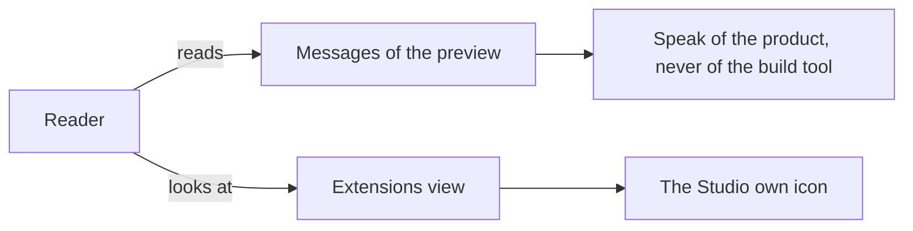

## Visible text and the icon speak of the product

### Normative behavior

When the Studio shows a text to the reader or appears in the Extensions view, the Studio SHALL speak of the product, never naming its internal build tool and showing its own icon.

### Preserved stakeholder intent

As a reader, I see messages that speak of the preview, not of the tools that built it, and I recognise the Studio in the Extensions view by its own icon.

### Rationale and constraints

- The opt-in behaviour of the Studio, which leaves the built-in Markdown preview untouched, is specified in the lifecycle-sync scope.
- Messages to the reader speak of the preview and the Studio, not of the build tool, and the package shows one icon: images/logo.png, a 256 by 256 pixel PNG (SwRS-MDOKFSTUDIO-TRUST-074).

### Use case diagram

### Main paths

#### Path S1: Read a text of the preview

1. The Studio shows a text to the reader
   - SwRS-MDOKFSTUDIO-TRUST-070: the text never mentions the build tool
2. The reader reads a text that speaks of the preview

#### Path S2: Find the Studio in the Extensions view

1. The Studio appears in the Extensions view
   - SwRS-MDOKFSTUDIO-TRUST-074: the package declares its 256 pixel PNG icon
2. The reader recognises the Studio by its own icon

<!-- okf:links:start -->
### Links

<!-- Generated from the frontmatter relations; edit them instead. -->

- Derived by:
  - [SwRS-MDOKFSTUDIO-TRUST-070](../../swrs/trust-security/SwRS-MDOKFSTUDIO-TRUST-070.md): Visible text speaks of the product, not of its build tool
  - [SwRS-MDOKFSTUDIO-TRUST-074](../../swrs/trust-security/SwRS-MDOKFSTUDIO-TRUST-074.md): The package declares its 256 pixel PNG icon
<!-- okf:links:end -->
