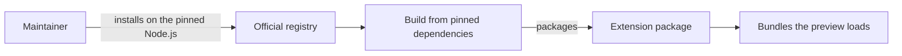

## The extension is built from pinned dependencies and ships what it loads

### Normative behavior

When a maintainer installs, builds and packages the Studio, the Studio SHALL be built from pinned, official dependencies and keep in its package the bundles the preview loads.

### Preserved stakeholder intent

As a maintainer, I install on the pinned Node.js version from the official registry, and when I package the Studio the bundles the preview loads are in the package.

### Rationale and constraints

- The built-in PlantUML engine is an exact dependency version because earlier versions carry a copyleft licence.
- The built-in PlantUML engine and the page runtime are files of the bundle folder, not inline code.
- The package keeps the folder out/bundle, with the built-in engine bundle and its licence, and leaves out only build leftovers (SwRS-MDOKFSTUDIO-TRUST-092); the pinned dependencies are SwRS-MDOKFSTUDIO-TRUST-075.

### Use case diagram

### Main paths

#### Path S1: Install and package from pinned dependencies

1. A maintainer installs the Studio on the pinned Node.js version
   - SwRS-MDOKFSTUDIO-TRUST-075: Node.js 24 is pinned, the lock file resolves from the official registry and the built-in PlantUML engine has one exact version
2. The Studio is built from pinned, official dependencies
   - SwRS-MDOKFSTUDIO-TRUST-092: the package keeps out/bundle, with the engine bundle and its licence, and leaves out only build leftovers
3. The package holds the bundles the preview loads

#### Path S2: Lint and draw the use case diagrams

1. A maintainer runs the requirements lint
   - SwRS-MDOKFSTUDIO-CORE-090: the lint parses the Mermaid fence of every use case diagram and fails naming the file, the line and the use case
2. Every use case diagram parses
   - SwRS-MDOKFSTUDIO-CORE-087: the Pages site build draws each diagram as an inline SVG under the user need
3. The site shows the use case diagrams

<!-- okf:links:start -->
### Links

<!-- Generated from the frontmatter relations; edit them instead. -->

- Derived by:
  - [SwRS-MDOKFSTUDIO-CORE-087](../../swrs/rendering-core/SwRS-MDOKFSTUDIO-CORE-087.md): The site requirements viewer shows the use case diagram of a StRS
  - [SwRS-MDOKFSTUDIO-CORE-090](../../swrs/rendering-core/SwRS-MDOKFSTUDIO-CORE-090.md): The requirements lint parses every use case diagram
  - [SwRS-MDOKFSTUDIO-TRUST-075](../../swrs/trust-security/SwRS-MDOKFSTUDIO-TRUST-075.md): The extension is built from pinned, official dependencies
  - [SwRS-MDOKFSTUDIO-TRUST-092](../../swrs/trust-security/SwRS-MDOKFSTUDIO-TRUST-092.md): The package keeps the built-in engine bundle in the VSIX
<!-- okf:links:end -->
