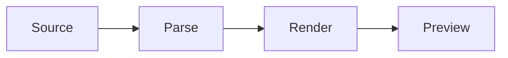

# Writing Markdown for Markdown OKF Schema Studio

Markdown OKF Schema Studio is a VS Code extension that renders Markdown as a styled page (themes
Cream, White, Dark) and lets the reader click a block to edit it. You already know CommonMark, GFM,
MyST, Mermaid, PlantUML, SVG and Vega-Lite. This skill says only what the extension renders, what
it does not, and how to choose. Every example here is rendered by its own pipeline in a test.

- **OKF**, the Open Knowledge Format: a folder with sub-folders of Markdown files that carry YAML
  front matter.
- **OKF-Schema**: a separate tool that provides JSON Schemas for OKF bundles
  (https://github.com/gsemet/okf-schema) and validates the front matter of the Markdown files. Full
  validation needs it installed: `uv tool install okf-schema` (commands `okf-schema`, `okfkb`,
  `okfreq`). The extension only helps to visualise the schema (field descriptions, enum values) and
  does not replace the validator.
- OKF-Schema and Markdown OKF Schema Studio have the same author.

## Install the extension

The skill only writes the documents; the reader needs the extension to see them. If it is missing,
tell the user to install it from the
[VS Code Marketplace](https://marketplace.visualstudio.com/items?itemName=GaetanSemet.markdown-okf-schema-studio),
with `code --install-extension GaetanSemet.markdown-okf-schema-studio`, or by searching for
"Markdown OKF-Schema Studio" in the Extensions view.

## What renders

| Family | Syntax rendered |
| --- | --- |
| GFM | headings, tables with `:--` `--:` alignment, task lists `- [ ]`, footnotes `[^1]`, alerts `> [!NOTE]` (also TIP, IMPORTANT, WARNING, CAUTION), autolinks, `~~strike~~` |
| Code | fenced code with a language (highlighted), `{code-block}` with `:caption:`, `:linenos:` |
| Math | `$x^2$`, `$$ ... $$`, `{math}` |
| Admonitions | `:::{note}` `tip` `warning` `important` `danger` ... with an optional title; fold with `:class: dropdown`; `{versionadded}` `{versionchanged}` `{deprecated}` |
| Layout | `{card}` (`:header:` `:footer:`), `{grid}` + `{grid-item-card}`, `{tab-set}` + `{tab-item}`, `{figure}`, `{list-table}` |
| Inline | `{kbd}`, `{ref}` to a `(name)=` label above a heading, definition lists (`Term` then `: text`) |
| Diagrams | `mermaid` fence, `plantuml` fence (built in, no Java), `{uml} file.puml` |
| Charts | `vega-lite` and `vega` fences, JSON or YAML, inline `values` or a relative CSV, TSV, JSON file |
| Images | `` and `{figure}` for local PNG, JPEG, SVG files (raw SVG: see below) |
| Navigation | `[TOC]` or `[[_TOC_]]` alone on a line, or `{contents}` (`:depth: 2`, `:local:`) |
| README HTML | `<div align>`, `<p align>`, ``, `<picture>`, `<details>`, `<kbd>`, `<sub>`, `<sup>` |
| Metadata | YAML front matter shows as a properties table (OKF, validated by OKF-Schema) |
| Review | `<!-- TODO: text -->` and `<!-- THREAD ... -->` comments show as chips |

The palette mode (Strict, GFM, MyST, Full) only chooses the buttons of the reader's editing
palette. Every syntax above renders in every mode: write MyST freely, never downgrade to GFM.

## Taste: choose, do not stack

- One visual per idea, only where it beats a sentence. A plan of six sections wants two to four
  visuals, not twelve. Open with a short summary, then structure, then detail.
- Concepts, architecture, layers, before and after: a **hand-drawn SVG**. It is the most
  effective way to show an idea; write it as a file (below).
- Flows, states, dependencies, timelines: **Mermaid**. Interactions between actors, class or
  component diagrams: **PlantUML**.
- Numbers (estimates, benchmarks, counts): **Vega-Lite**. A **table** when the reader compares
  exact values over three columns or more.
- Alternatives to decide between: **tabs** or a comparison table. Parallel items (phases,
  options, risks): **cards** in a grid. One highlighted fact: a single **card**.
- **Admonitions** and alerts sparingly: one per section at most, for what the reader must not
  miss (warning, decision, assumption). Never wrap ordinary paragraphs.
- `[TOC]` after the title only when the document has more than about six headings.
- One H1, descriptive headings, short paragraphs, lists nested at most two levels, lines wrapped
  at 100 columns.
- Front matter: when the project has an OKF schema, copy the fields of its sibling documents;
  otherwise `title`, `description`, `status`, `date`.

## Raw SVG

Inline `<svg>` in Markdown is dropped. Write the picture to a file next to the document
(`diagrams/layers.svg`) and show it with `{figure}` or ``. Give the SVG
a `viewBox`, its own background rectangle and mid-tone strokes so it reads on Cream, White and
Dark; no scripts, no external fonts, no `foreignObject`. Keep text at 14 px or more.

````markdown
```{figure} diagrams/layers.svg
:width: 80%
:alt: Three layers: page, session, core

The extension is three layers; each imports only the one below.
```
````

## Cards, tabs, charts

````markdown
::::{grid} 1 1 3 3
:::{grid-item-card} Phase 1
:header: Week 1
Parser and schema.
:::
:::{grid-item-card} Phase 2
:header: Week 2
Renderer and tests.
:::
::::

:::{card} Decision
:header: Accepted 2026-10-28
:footer: Revisit after the pilot
We ship behind a flag.
:::

::::{tab-set}
:::{tab-item} Option A
Cheap, slow.
:::
:::{tab-item} Option B
Costly, fast.
:::
::::



```vega-lite
data:
  values:
    - {phase: Parser, days: 3}
    - {phase: Renderer, days: 5}
mark: bar
encoding:
  x: {field: phase, type: nominal}
  y: {field: days, type: quantitative}
```
````

More copy-ready examples (alerts, admonitions, version notes, TOC, math, list table, PlantUML,
front matter, review comments, README HTML): [references/examples.md](references/examples.md).

## Limits

- Dropped: inline `<svg>`, `<script>`, `<style>`, `<iframe>`, forms, event handlers.
- No remote resources: no `https://` images, chart data, fonts or PlantUML `!include` URLs.
  Download the file next to the document; `data:` URIs work.
- Built-in PlantUML: no URL includes, no standard library (`!include <C4/...>`).
- Not rendered: `[[toc]]` (use `[TOC]`), emoji shortcodes such as `:smile:`, bare
  `{dropdown}` (use `:class: dropdown`). An unknown directive shows as a warning box: write
  only the names above.
- Restricted Mode (untrusted workspace) renders everything above; included files and chart data
  stay inside the document's folder.

<!-- @implements_req SwRS-MDOKFSTUDIO-CORE-073 -->
<!-- @implements_req SwRS-MDOKFSTUDIO-CORE-074 -->
