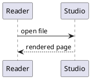

# More examples for Studio

Each block is a complete document; all of them are rendered by Studio's test.

A plan that asks the reader to decide: each choice is a radio group, the recommended option
preselected, and the reader's click moves the `x` in the file:

````markdown
# Plan: faster preview start

The preview takes two seconds to open on large files.

Approach:

- (x) Render the visible blocks first, the rest in the background
- ( ) Cache the rendered page between sessions
- ( ) Leave as is

Rollout:

- ( ) Behind a setting first
- (x) On by default in the next release

## Tasks

- [ ] Measure the start time on the three largest files
- [ ] Implement the chosen approach
````

Alerts, admonitions, a folding admonition and a version note:

````markdown
> [!WARNING]
> The migration is not reversible.

:::{tip} Rollout order
Ship the reader first, then the writer.
:::

:::{note} Assumptions
:class: dropdown
The pilot team has five people.
:::

:::{versionadded} 0.47
Adds the export command.
:::
````

Front matter, table of contents, label and reference, math, list table:

````markdown
---
title: Export plan
status: draft
---

# Export plan

[TOC]

(cost)=
## Cost

The cost is $c = n \cdot t$ (see {ref}`cost`), with

$$
t = \sum_{i=1}^{n} t_i
$$

```{list-table} Phases
:header-rows: 1

* - Phase
  - Effort
* - Parser
  - 3 d
* - Renderer
  - 5 d
```

- [x] Parser done
- [ ] Renderer started
````

A PlantUML sequence and a PlantUML diagram kept in its own file (`diagrams/flow.puml`):

````markdown


```{uml} diagrams/flow.puml
```
````

Review notes for the reader, and README-style HTML:

````markdown
<!-- TODO: confirm the budget with finance -->

<!-- THREAD
Ada (2026-10-28 10:00):
  Is week 3 realistic?
-->

<div align="center">

**Export plan** v0.47

</div>
````
