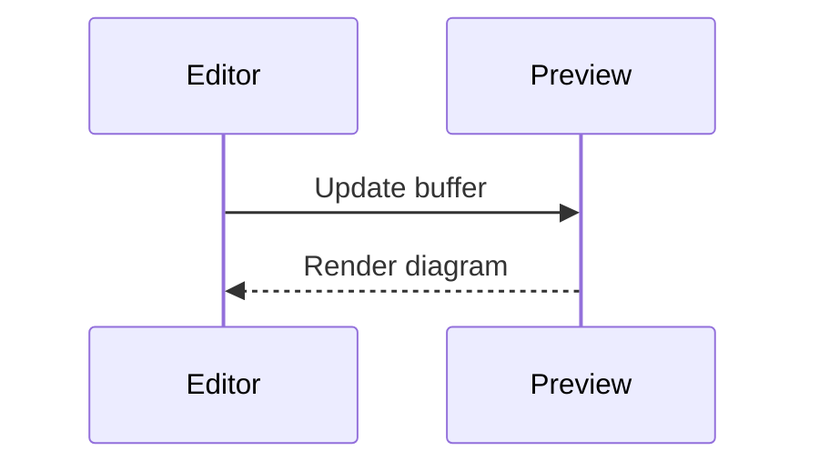

# Unresolved constructs

The preview renders one buffer at a time. Anything that needs a project-wide
build must degrade into an inert, readable placeholder instead of vanishing.

## Citations

A single citation {cite}`kessler2021` sits inline with surrounding prose and
must not break the paragraph in two.

A citation group {cite}`kessler2021,okoye2019,vartanen2023` appears mid-sentence
here, and the words after it — these exact words — must stay in the same
paragraph as the words before it.

Nested inside a list:

- first item with a citation {cite}`okoye2019` and trailing text,
- second item with no citation at all,
- third item with two groups {cite}`kessler2021` and {cite}`vartanen2023`.

Inside an admonition:

:::{note}
Even here the citation {cite}`vartanen2023` must stay inline, and this trailing
sentence must remain part of the same paragraph.
:::

## Directives that need a full build

```{animation} throughput-by-region.js
:caption: Regional throughput over one quarter
```

The paragraph after an unresolved directive must render normally.

```{bibliography}
```

```{toctree}
:maxdepth: 2

02-depots
03-planner
04-tracker
```

## Directives with a body

```{mermaid}
graph LR
  intake --> planner
  planner --> tracker
  tracker --> archive
```



```{csv-table} Depot capacity
:header: Depot, Bays, Shifts

nw-01, 18, 3
nw-03, 6, 2
nw-07, 24, 3
```

## Roles

An unresolved cross reference {ref}`depot-topology` and a numbered reference
{numref}`fig-depot-graph` both appear inline.

A download role {download}`the manifest schema <schema/manifest.json>` and an
abbreviation {abbr}`ETA (estimated time of arrival)` close the section.

## Figures

```{figure} ../external-img/depot-graph.svg
:name: fig-depot-graph
:width: 640px

The depot graph as of the last quarterly review {cite}`okoye2019`.
Captions carry citations more often than body text does.
```

Final paragraph, after the figure.
