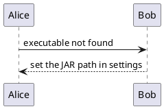

# PlantUML executable failure

This diagram uses a deliberately missing executable. The preview should show an actionable
settings message instead of failing the screenshot campaign, while keeping the source available.

