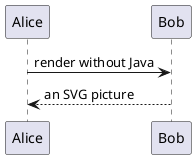

# PlantUML built-in engine

The preview renders these diagrams with the PlantUML engine bundled in the extension: no Java,
no `plantuml` command and no network.



```{plantuml}
@startuml
class Document {
  +title: String
}
class Diagram
Document "1" *-- "many" Diagram : contains
@enduml
```

The text after the diagrams continues normally.
