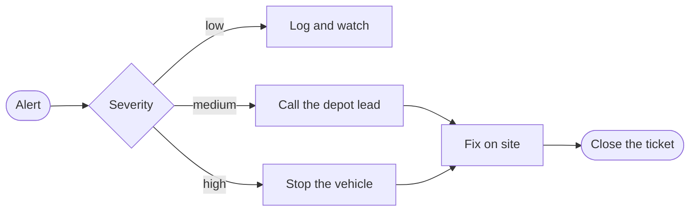
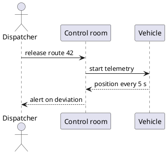

# Fleet Operations Handbook

Every vehicle follows the same loop: plan the day, dispatch, observe and correct. This page is the
short version that dispatchers and depot leads keep open during a shift.

::::{grid} 1 1 3 3
:gutter: 3

:::{grid-item-card} Plan
Match vehicles, drivers and routes the evening before.
+++
Owner: dispatch
:::

:::{grid-item-card} Dispatch
Release each vehicle once its **departure check** is green.
+++
Owner: depot leads
:::

:::{grid-item-card} Observe
Follow telemetry and act on the alerts that matter.
+++
Owner: control room
:::
::::

:::::{note} Before the first departure
Run the departure check on every vehicle that left the depot less than six hours ago.

:::{warning} Cold starts
Below 0 °C, hold the vehicle for ten minutes before releasing it to a route.
:::
:::::

```{figure} ../external-img/fleet-loop.svg
:width: 640px
:align: center
:alt: Fleet operating loop

The fleet operating loop: plan, dispatch, observe, correct.
```

## Escalation paths





## Service levels

| Service | Owner | Build | Tests | Coverage | Latency p95 | Error budget | Next release | Rollback |
|---|---|---|---|---|---|---|---|---|
| gateway | platform | 1.42.0 | passing | 91 % | 118 ms | 82 % left | Tuesday | automatic |
| scheduler | fleet | 2.7.3 | passing | 88 % | 64 ms | 95 % left | Thursday | automatic |
| telemetry | data | 0.19.1 | passing | 84 % | 203 ms | 61 % left | Friday | manual |
