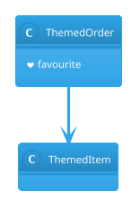

# PlantUML bundled theme and sprite

The built-in engine draws a diagram that selects a theme of the bundled library and uses an
OpenIconic icon, with no network and no Graphviz.

The text after the diagram continues normally.
