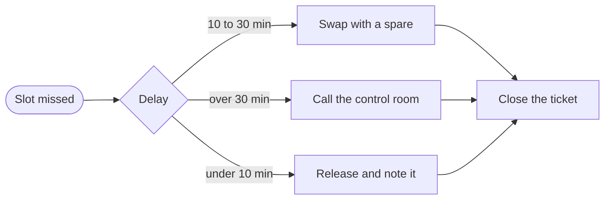

# Depot throughput review, third quarter

Three months ago a vehicle needed an average of 112 minutes between coming back from a route and
leaving on the next one. Dispatch had learned to plan around that number, and the number had
quietly become the reason that the morning wave left late on every busy Monday.

This review explains what changed since then. We did not buy chargers or hire inspectors. We
moved two checks earlier in the sequence, stopped inspecting vehicles that had no faults reported,
and gave the depot leads one dashboard instead of four. Each change is small on its own, and the
combined effect is the 27 minutes shown below.

The page is meant to be read in one sitting by dispatchers and depot leads. It starts with the
sequence a vehicle follows, then compares the depots, then looks at the trend and the escalation
path. Everything on it comes from the telemetry export of the last quarter.

```{figure} ../external-img/depot-throughput.svg
:width: 100%
:align: center
:alt: The four stages of a vehicle's day at the depot

The four stages of a turnaround. Charging dominates, which is why the inspection moved before it.
```

## What a turnaround contains

A turnaround has four stages and they always run in the same order. Arrival is the gate scan and
the driver hand-in. Inspection is the twelve point check. Charging brings the battery to 90 % and
release is the handover to the next driver. Only charging cannot be shortened by process alone.

Because charging dominates, the biggest saving came from starting it earlier. Inspection now runs
while the cable is already connected, and only the vehicles with a reported fault wait for a
technician before they charge.

| Stage | Before | After | Change |
|---|---|---|---|
| Arrival | 9 min | 5 min | -4 min |
| Inspection | 31 min | 18 min | -13 min |
| Charging | 62 min | 55 min | -7 min |
| Release | 10 min | 7 min | -3 min |

The savings add up to 27 minutes per vehicle, and 85 minutes is now the median turnaround. The
table above is the average over all depots, and the averages hide large differences between them.

## Depot by depot

The depot scorecard below has one row per depot and a column for each number the leads look at
during the morning meeting. It is wider than a comfortable reading line on purpose: every column
keeps its full header and its cells stay on one line, so the leads can compare depots at a glance.

| Depot | Region | Vehicles | Chargers | Turnaround | Inspection | Faults | Late releases | Utilisation | Overtime | Backlog | Lead |
|---|---|---|---|---|---|---|---|---|---|---|---|
| Lyon North | Rhone | 148 | 52 | 79 min | 16 min | 3.1 % | 4 | 91 % | 12 h | 2 | Ana |
| Lyon South | Rhone | 96 | 30 | 84 min | 18 min | 4.0 % | 7 | 87 % | 21 h | 5 | Bo |
| Grenoble | Isere | 72 | 28 | 81 min | 17 min | 2.7 % | 3 | 89 % | 9 h | 1 | Chen |
| Dijon | Cote-d'Or | 64 | 20 | 93 min | 22 min | 5.4 % | 11 | 82 % | 34 h | 8 | Dara |
| Clermont | Puy-de-Dome | 58 | 24 | 86 min | 19 min | 3.6 % | 5 | 85 % | 15 h | 3 | Eli |
| Saint-Etienne | Loire | 41 | 14 | 88 min | 20 min | 4.2 % | 6 | 84 % | 18 h | 4 | Fay |

Dijon stands out. It has the fewest chargers per vehicle and the highest fault rate, and those two
facts explain most of its late releases. The other depots sit within a few minutes of each other.

## The trend

The chart plots the median turnaround per month. The drop in July is the earlier inspection, the
step in August is the single dashboard, and the flat September is the quarter without new changes.

```vega-lite
{
  "width": 560,
  "height": 220,
  "data": { "values": [
    { "month": "Jun", "minutes": 112 }, { "month": "Jul", "minutes": 101 },
    { "month": "Aug", "minutes": 91 }, { "month": "Sep", "minutes": 85 }
  ] },
  "layer": [
    { "mark": { "type": "line", "point": true, "strokeWidth": 3 } },
    { "mark": { "type": "text", "dy": -14, "fontSize": 13 }, "encoding": { "text": { "field": "minutes", "type": "quantitative" } } }
  ],
  "encoding": {
    "x": { "field": "month", "type": "ordinal", "sort": ["Jun", "Jul", "Aug", "Sep"], "title": "Month", "axis": { "labelAngle": 0 } },
    "y": { "field": "minutes", "type": "quantitative", "title": "Median turnaround (min)", "scale": { "domain": [70, 120] } }
  }
}
```

Flat is not the same as finished. The target for the next quarter is 75 minutes, and the remaining
gap is almost entirely charging at the three depots that lack chargers.

## When a vehicle misses its slot

A vehicle that is not ready at its release time follows one of three paths, depending on how far
behind it is. The depot lead owns the decision, and the control room is only told when the delay
reaches the third path.



Most late releases end on the first path. The swap is used about twice a week, and the control
room has been called five times this quarter, all of them at Dijon.

## Conclusion

The faster turnaround came from ordering the work differently, not from adding resources. The next
step needs hardware: chargers for Dijon, Clermont and Saint-Etienne. Until they arrive we will keep
the process as it is and report the same four numbers every month.
