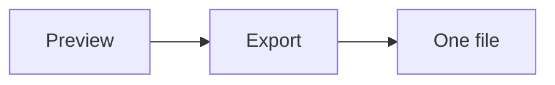

# Exported release checklist

This page is saved as one file. It has an [external link](https://example.com/guide), a [link to another page](01-handbook-overview.md) that the file drops, and the inline math $a^2 + b^2 = c^2$.

<!-- TODO confirm the checklist with the release owner -->

::::{tab-set}
:::{tab-item} First tab
The first panel is shown when the file opens.
:::
:::{tab-item} Second tab
The second panel appears after a click on its label.
:::
::::

:::{admonition} Read more
:class: dropdown

The hidden body of the dropdown opens without JavaScript.
:::

