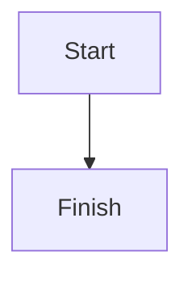

# Raw copy

Intro with **bold** and a [link with **strong** words](https://example.com/page) here.

---

| Name | Value |
| ---- | ----- |
| one  | first |
| two  | second |

::::{warning} Outer
- item one
- item two
  - deeper

:::{note} Inner
```python
x = 1
y = 22
```
:::
::::

:::{note} Next
Next body.

| key | val |
| --- | --- |
| left | right |
:::



Closing line.

[ref]: https://example.com/ref

<!-- trailing comment -->
