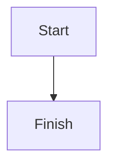

# Raw copy

Intro with **bold** and a [link with **strong** words](https://example.com/page) here.

---

| Name | Value |
| ---- | ----- |
| one  | first |
| two  | second |

::::{warning} Outer
- item one
- item two
  - deeper

:::{note} Inner
```python
x = 1
y = 22
```
:::
::::

:::{note} Next
Next body.

| key | val |
| --- | --- |
| left | right |
:::



Closing line.

:::{note} Edge
Edge **world** again.
:::

A [link **sturdy** text](https://example.com/link) ending.

Before.

::::{note}
Outer a.

- item a

  :::{warning}
  Inner text.
  :::

  Item tail.

- item b

Outer z.
::::

After.

- step one

  ```
  run_now()
  then_go()
  ```

Code after.

## Hello

Heading after.

Term one
: definition words here

Term two
: other def

Definition after.

:::{note} Grid table
Lead text.

| head a | head b |
| ------ | ------ |
| cell **robust** | cell c |
| cell d | cell e |

:::

Table after.

- parent
  - child **mighty**
  - sibling
- next

:::{note} Left
Left body words.
:::

:::{tip} Right
Right body words.
:::

::::{tab-set}
:::{tab-item} Tab one
Tab one para.
:::
:::{tab-item} Tab two
Tab two para.

- tab list alpha
- tab list bravo
:::
::::

Tabs after.

Clean one.

Clean two.

[ref]: https://example.com/ref

<!-- trailing comment -->
